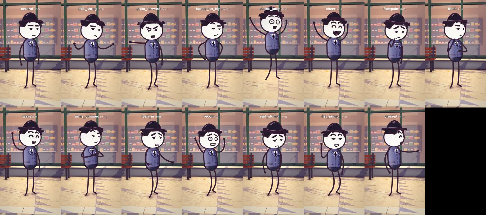
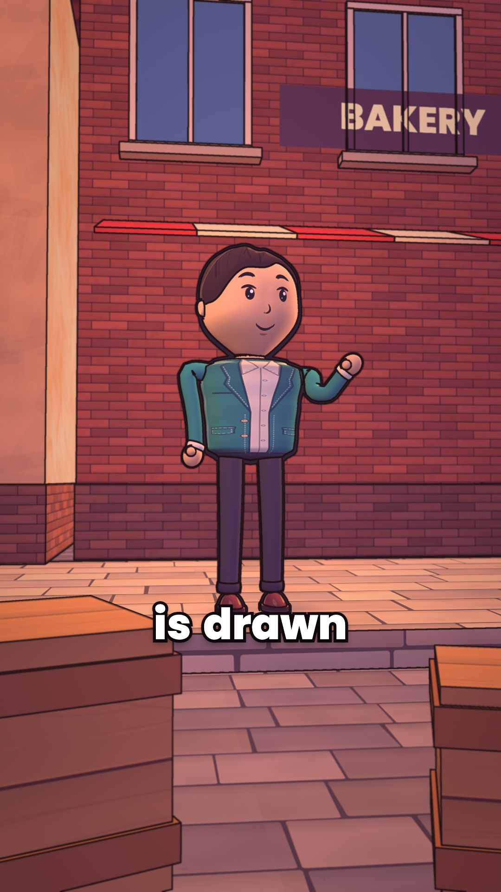
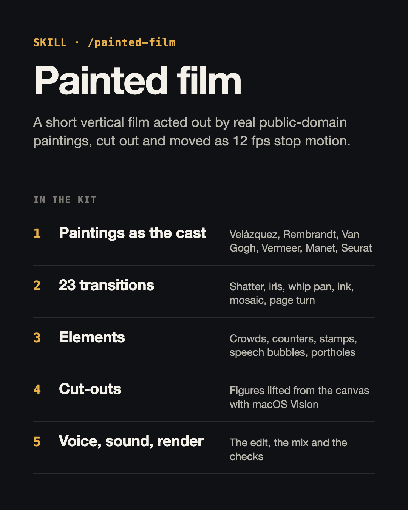
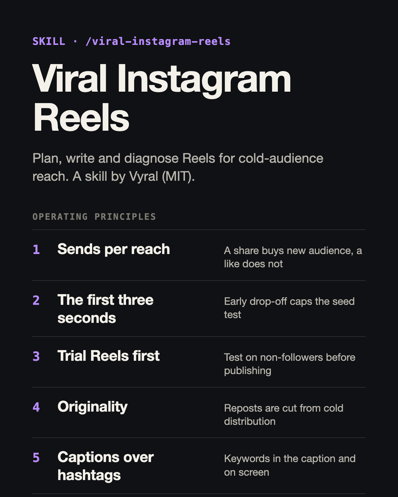

# Videos

Claude Code skills for making short-form videos (Reels, TikTok, Shorts). The skills live in
[`.claude/skills/`](.claude/skills), so Claude Code picks them up as soon as you open this folder. Each one has a
still in [`previews/`](previews).

## The skills

| Skill | What it does | Still |
|---|---|---|
| [`stickman-3d`](.claude/skills/stickman-3d) | Shorts acted by 3D stickmen: sets built in Blender, rendered in three.js and Remotion with ink lines, grade and motion blur. Experimental. The still is the skill's pose sheet. |  |
| [`inkbeat-shorts`](.claude/skills/inkbeat-shorts) | Toon-shaded 3D cartoon videos in Remotion and React Three Fiber: beat-driven camera, ink outlines, flicker fixes, captions, sound and QA. The still is the starter project's demo frame. |  |
| [`painted-film`](.claude/skills/painted-film) | A short vertical film acted out by public-domain paintings, moving as 12 fps stop motion, with a kit of 23 transitions. |  |
| [`viral-instagram-reels`](.claude/skills/viral-instagram-reels) | Plan, write and diagnose Instagram Reels for cold-audience reach. By [Vyral](https://github.com/vyralcontent/content-skills), MIT. |  |

## Using them

Clone this repo and open it in Claude Code. Ask for a skill by name (`/painted-film`, `/inkbeat-shorts`) or describe
the job and Claude picks the matching one. To use a skill in another project, copy its folder into that project's
`.claude/skills/`.

## What you need to know first

- **`inkbeat-shorts` runs out of the box.** Copy `templates/` to a new folder, `npm install`, and render the demo
  (the commands are in `templates/README.md`).
- **`stickman-3d` needs setup:** Blender, Node, Python, ffmpeg and Mixamo animations you download yourself. Start
  with `.claude/skills/stickman-3d/references/SETUP.md`. Machine paths go in `package/config.json`, which you create
  with `stickman3d.py config --set`. The meter end card shows `template/public/app_icon.png` (a grey placeholder)
  and the name "Your App": swap in your own.
- **`painted-film` cuts figures out with macOS Vision,** so that step needs a Mac. Its notes name reference films
  that are not in this repo.
- **Voices and sound** in the film skills use ElevenLabs. Put your own key in a `.env` file. No keys are in this
  repo.
- Some notes mention folders from the project the skills were written in (`video-review/`, `warehouse.sh`). Use your
  own layout.

## Licences

`inkbeat-shorts` and several helper skills under `stickman-3d/package/sister_skills/` carry their own licence
files; keep them with the skill when you copy it. `viral-instagram-reels` is MIT, as stated at the top of its
`SKILL.md`.
